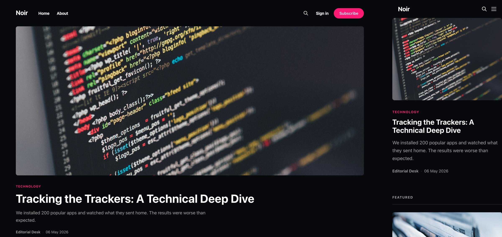
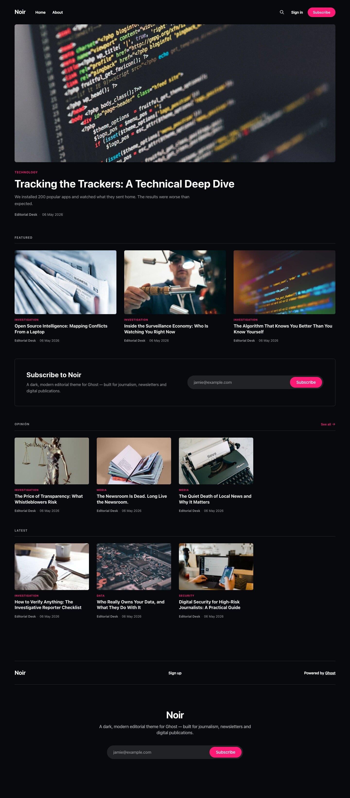
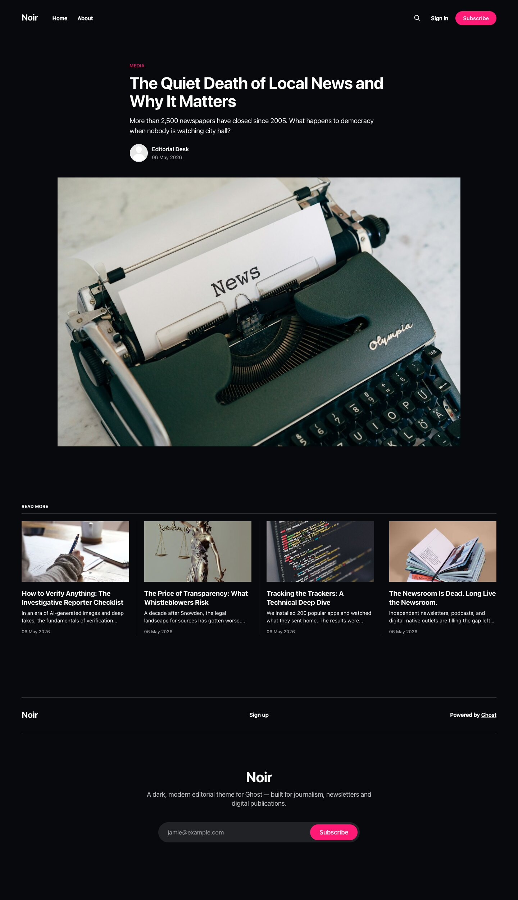
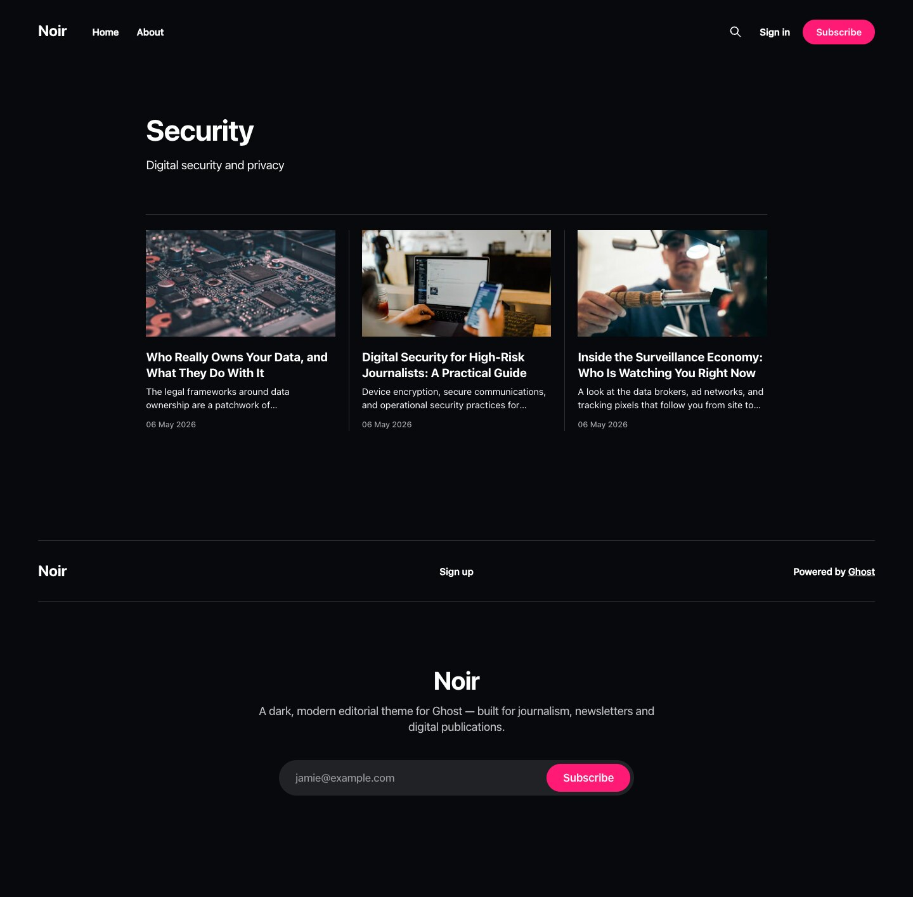
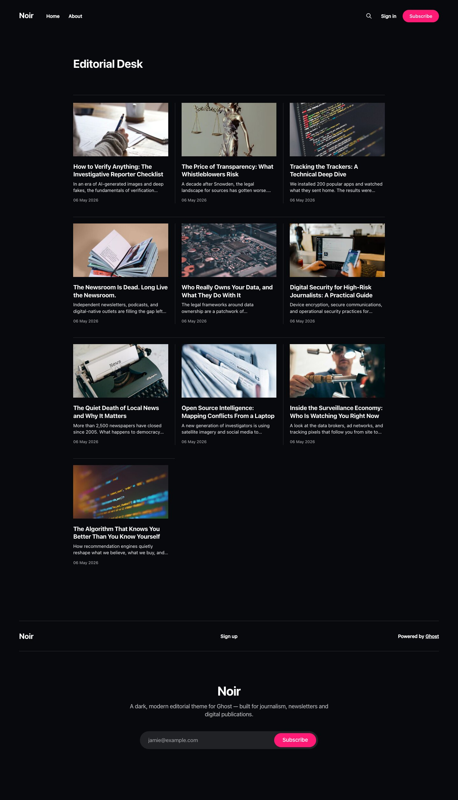
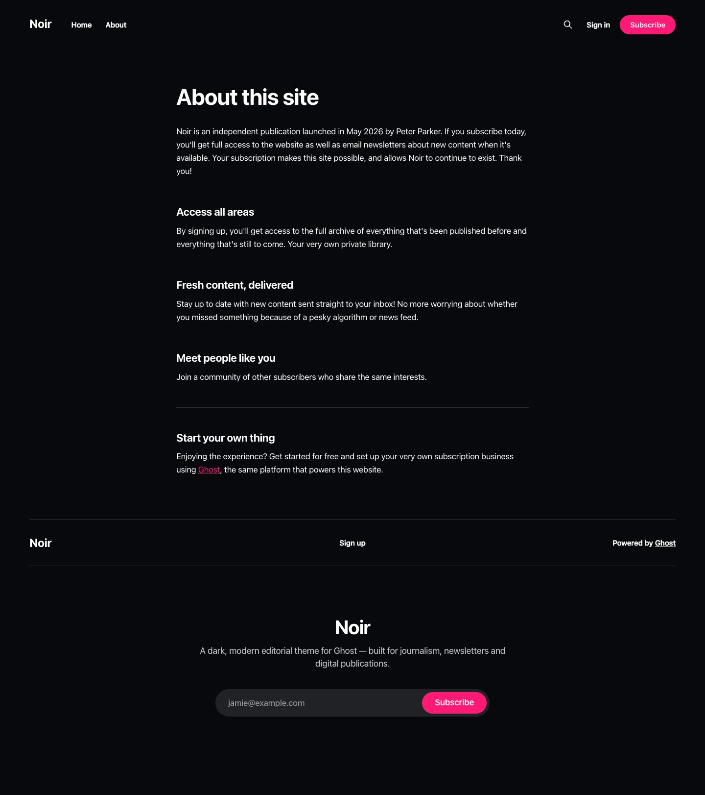
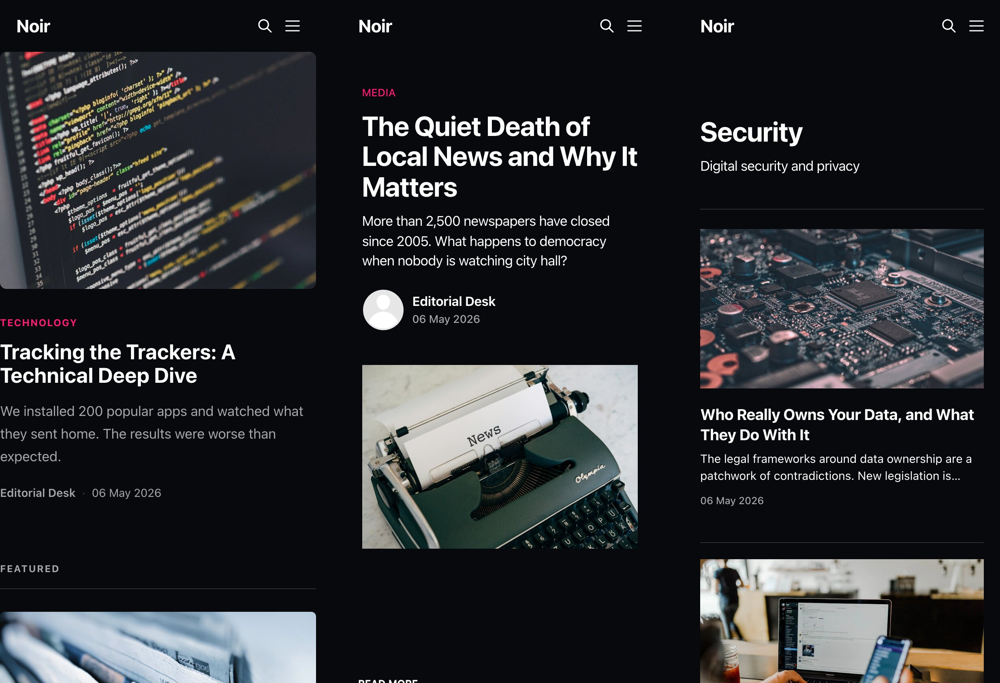

# Noir — Ghost Theme

> A dark, modern editorial theme for [Ghost](https://ghost.org/), built for journalism, newsletters, and digital publications that take their content seriously.

**[Screenshots](#screenshots)** · **[Download](https://github.com/luisassardo/noir/releases/latest)** · **[Report a bug](https://github.com/luisassardo/noir/issues)**



&nbsp;

## Features

- **Deep dark aesthetic** — `#08090d` background with carefully tuned contrast ratios for comfortable long-form reading
- **Self-hosted fonts** — Plus Jakarta Sans, EB Garamond, and JetBrains Mono loaded locally — no Google Fonts, no external requests
- **Three font pairs** — Switch between sans-serif, serif, and monospace title/body combinations from Ghost Admin
- **Curated homepage** — Five-row layout with automatic de-duplication: hero, featured posts, subscribe CTA, opinion section, and latest posts
- **Full Ghost feature support** — Members, subscriptions, tiers, search, comments, newsletters, recommendations
- **Multiple header styles** — Landing, Highlight, Magazine, Search, Off
- **Feed styles** — Grid and List modes
- **17 custom settings** — Configurable directly from Ghost Admin, no code required
- **13 languages** — Including Spanish
- **Lightbox** — PhotoSwipe integration for image galleries
- **Infinite scroll** — Automatic pagination on archive pages
- **Ghost card support** — Full styling for all Ghost editor cards
- **Accessible** — Keyboard navigation, ARIA labels, focus-visible styles, semantic HTML
- **SEO-friendly** — Structured data, proper heading hierarchy, clean markup

&nbsp;

## Screenshots

Captured from a Ghost 6.36 site running Noir (November 2026). The hosted demo was retired to cut hosting costs, so these captures stand in for it. To try Noir live, upload the [latest release](https://github.com/luisassardo/noir/releases/latest) to any Ghost site or run [Ghost locally](https://ghost.org/docs/install/local/).

<table>
  <tr>
    <td width="50%" valign="top"><br><sub><b>Homepage</b> · hero → featured → subscribe CTA → opinion → latest</sub></td>
    <td width="50%" valign="top"><br><sub><b>Post</b> · header, feature image, related posts</sub></td>
  </tr>
  <tr>
    <td width="50%" valign="top"><br><sub><b>Tag archive</b></sub></td>
    <td width="50%" valign="top"><br><sub><b>Author archive</b></sub></td>
  </tr>
  <tr>
    <td width="50%" valign="top"><br><sub><b>Page template</b></sub></td>
    <td width="50%" valign="top"><br><sub><b>Mobile</b> · homepage, post, tag archive</sub></td>
  </tr>
</table>

&nbsp;

## Installation

### Upload to Ghost Admin (recommended)

1. Download the [latest release](https://github.com/luisassardo/noir/releases/latest) zip file
2. Go to **Ghost Admin → Settings → Design & branding → Change theme → Upload theme**
3. Upload the zip and activate

### From source (development)

```bash
git clone https://github.com/luisassardo/noir.git
cd noir
npm install
npm run build
```

Then symlink or copy the folder into your Ghost `content/themes/` directory and restart Ghost.

&nbsp;

## Development

Noir uses [Gulp](https://gulpjs.com/) to compile CSS and JavaScript.

### Prerequisites

- Node.js v18+
- A running [Ghost](https://ghost.org/docs/install/) instance

### Commands

| Command | Description |
|---|---|
| `npm run dev` | Start development mode with live reload |
| `npm run build` | Build CSS and JS for production |
| `npm run zip` | Build and create a zip in `dist/` |
| `npm run test` | Validate theme with [GScan](https://gscan.ghost.org/) |
| `npm run test:ci` | Run GScan in strict/fatal mode |

### File structure

```
noir/
├── assets/
│   ├── built/           # Compiled CSS and JS
│   ├── css/             # Source CSS
│   ├── fonts/           # Self-hosted: Plus Jakarta Sans, EB Garamond, JetBrains Mono
│   ├── images/          # PhotoSwipe lightbox assets
│   └── js/              # Source JavaScript
├── locales/             # Translation files (13 languages)
├── partials/
│   ├── components/      # Navigation, header, footer, CTA, featured, post-list
│   ├── icons/           # SVG icon partials
│   └── typography/      # Font loading partials (sans, serif, mono)
├── default.hbs          # Main layout template
├── home.hbs             # Custom homepage
├── index.hbs            # Paginated post archive
├── post.hbs             # Single post template
├── page.hbs             # Static page template
├── tag.hbs              # Tag archive template
├── author.hbs           # Author archive template
├── error.hbs            # Error page
└── package.json         # Theme metadata and build config
```

&nbsp;

## Configuration

All settings are available in **Ghost Admin → Settings → Design & branding → Customize**.

### Typography

| Setting | Options | Default |
|---|---|---|
| Title font | Modern sans-serif / Elegant serif / Consistent mono | Modern sans-serif |
| Body font | Modern sans-serif / Elegant serif | Modern sans-serif |

### Homepage

| Setting | Options | Default |
|---|---|---|
| Header style | Landing / Highlight / Magazine / Search / Off | Landing |
| Post feed style | List / Grid | Grid |
| Show images in feed | On/Off | On |
| Show author | On/Off | On |
| Show publish date | On/Off | On |
| Show sidebar | On/Off | Off |
| Show featured posts | On/Off | Off |
| Background image | On/Off | On |

### Post

| Setting | Options | Default |
|---|---|---|
| Show post metadata | On/Off | On |
| Drop caps on posts | On/Off | Off |
| Show related articles | On/Off | On |

### Opinion section

The homepage opinion row filters posts tagged `opinion`. To use a different tag, edit `home.hbs` line 103:

```handlebars
{{#get "posts" filter="tag:your-tag-slug" include="authors,tags" limit="4"}}
```

&nbsp;

## Credits

- Based on [Source](https://github.com/TryGhost/Source) by Ghost Foundation (MIT)
- Built by [Luis Assardo](https://luisassardo.com)
- Typography: [Plus Jakarta Sans](https://fonts.google.com/specimen/Plus+Jakarta+Sans) by Tokotype · [EB Garamond](https://fonts.google.com/specimen/EB+Garamond) by Georg Duffner · [JetBrains Mono](https://www.jetbrains.com/lp/mono/) by JetBrains
- Lightbox: [PhotoSwipe](https://photoswipe.com/) by Dmitry Semenov

&nbsp;

## License

[MIT](LICENSE) — free to use, modify, and distribute.
